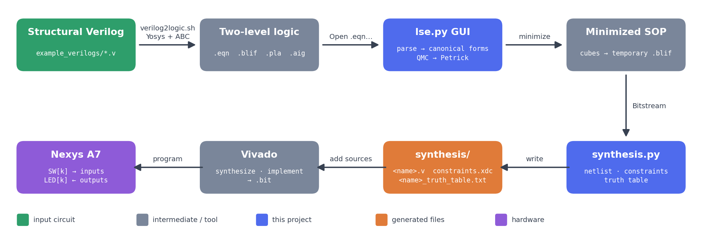
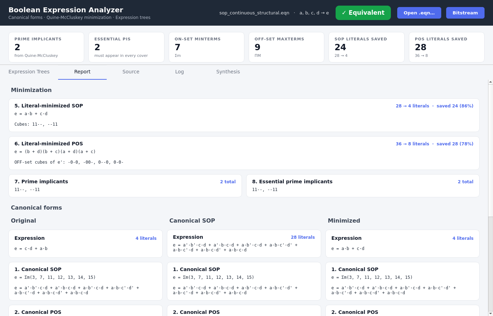
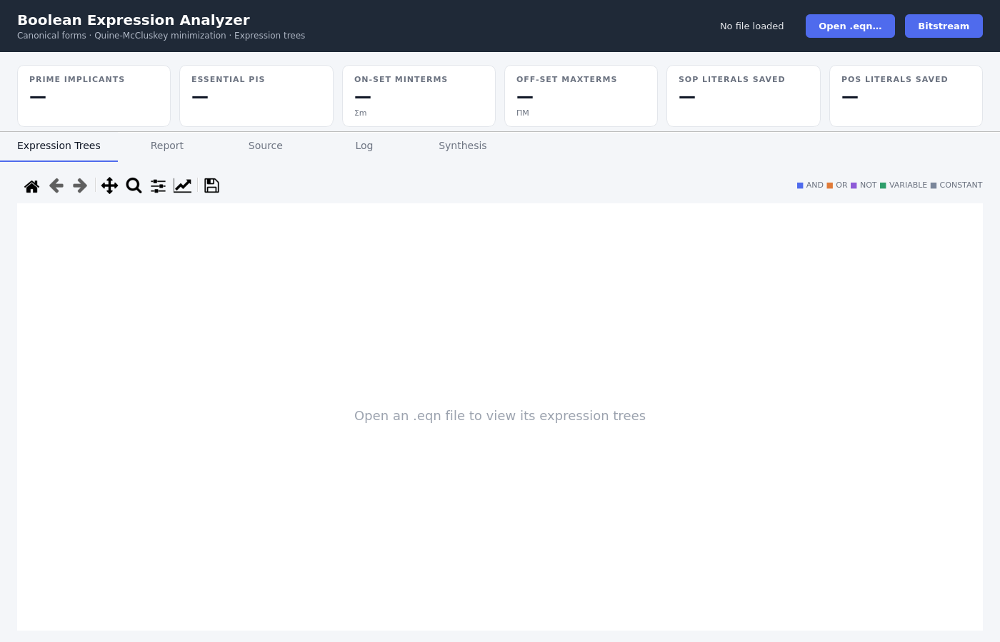
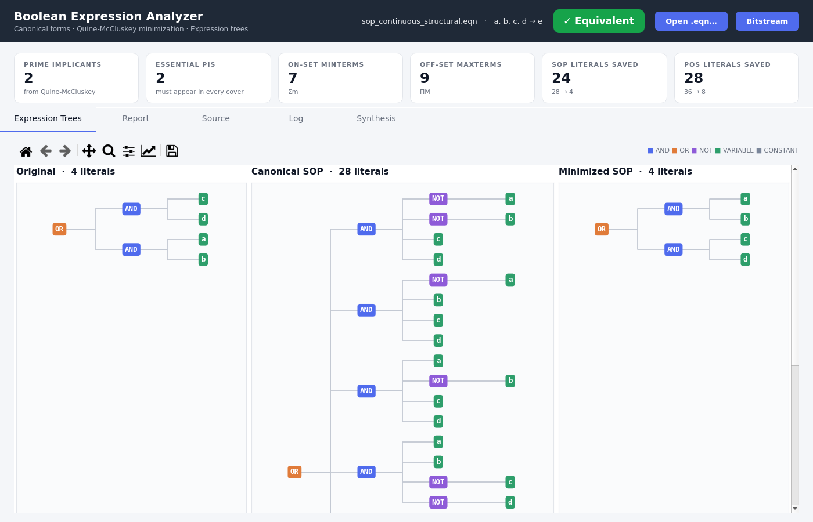
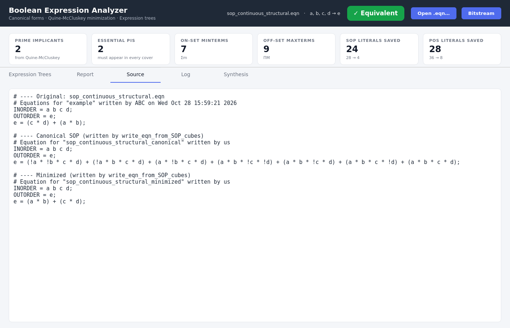
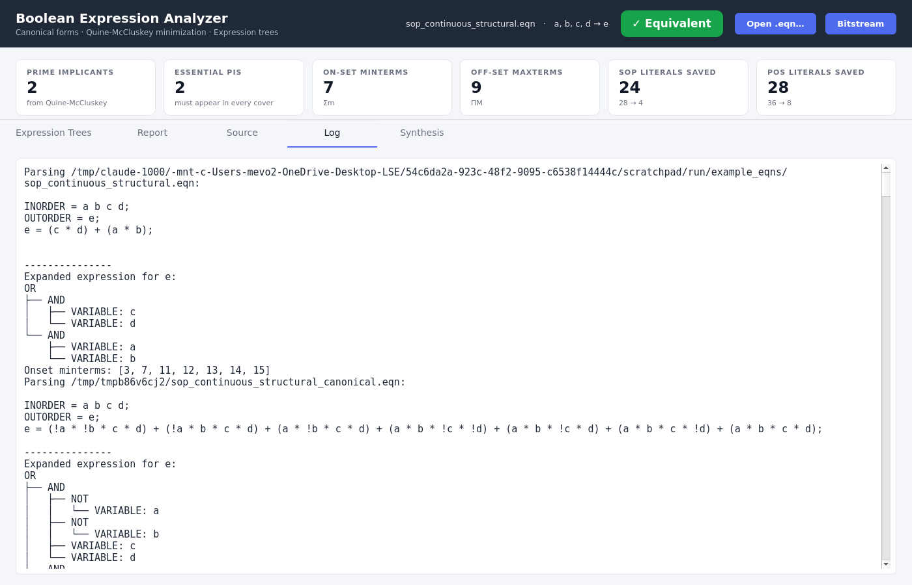
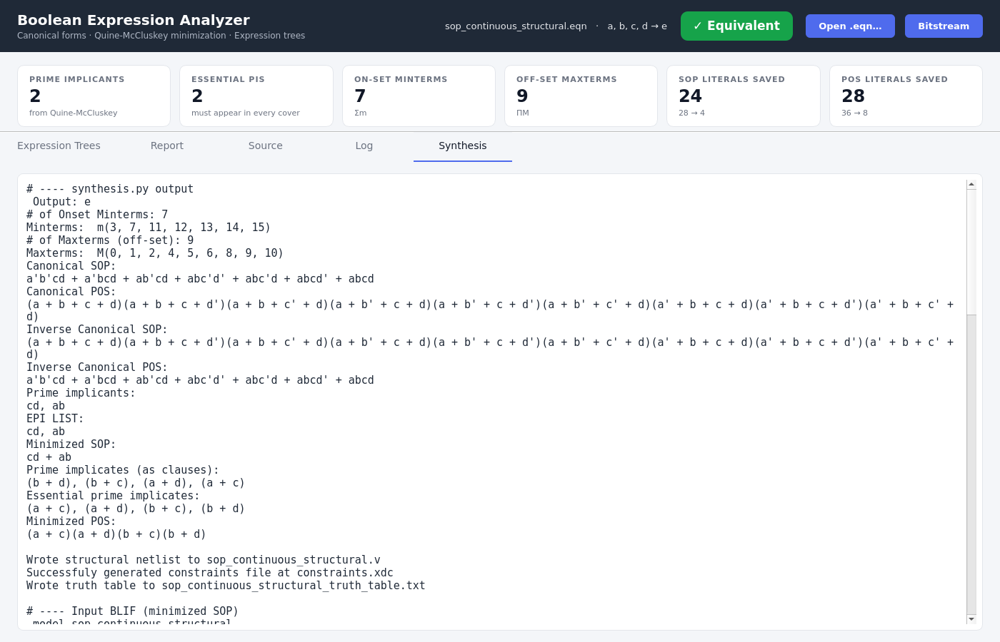
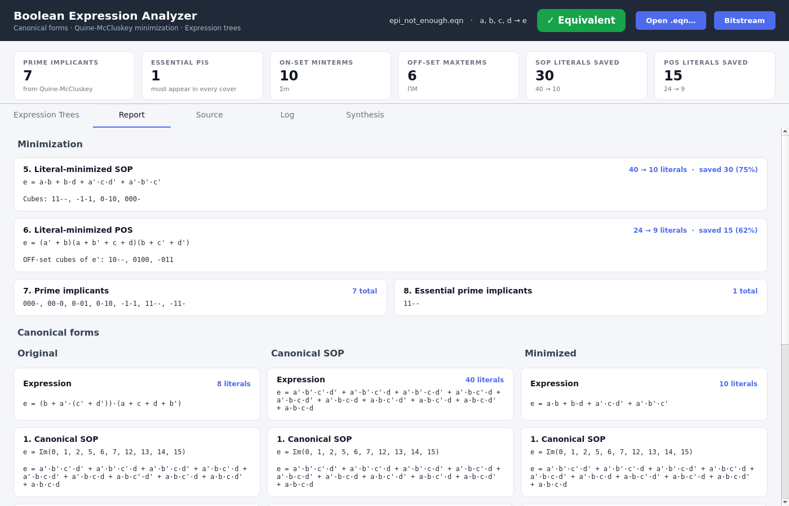
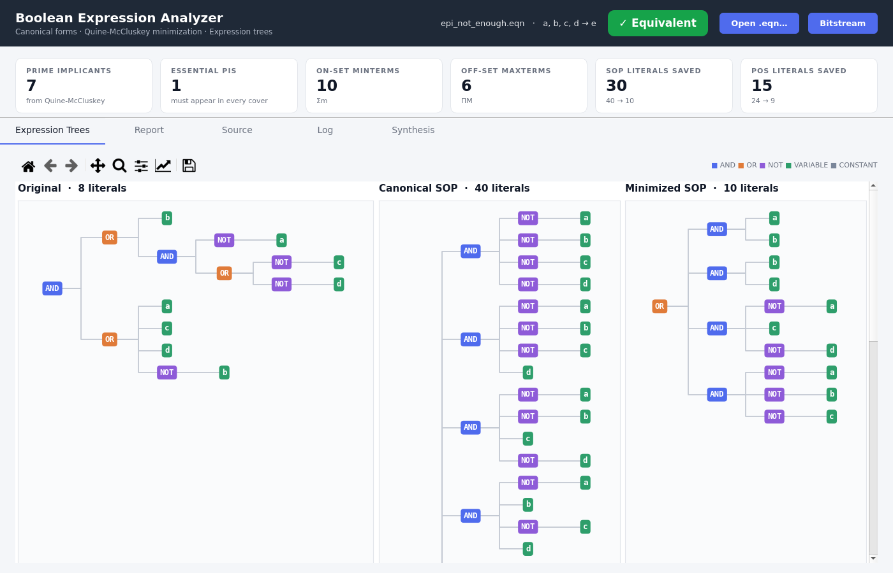
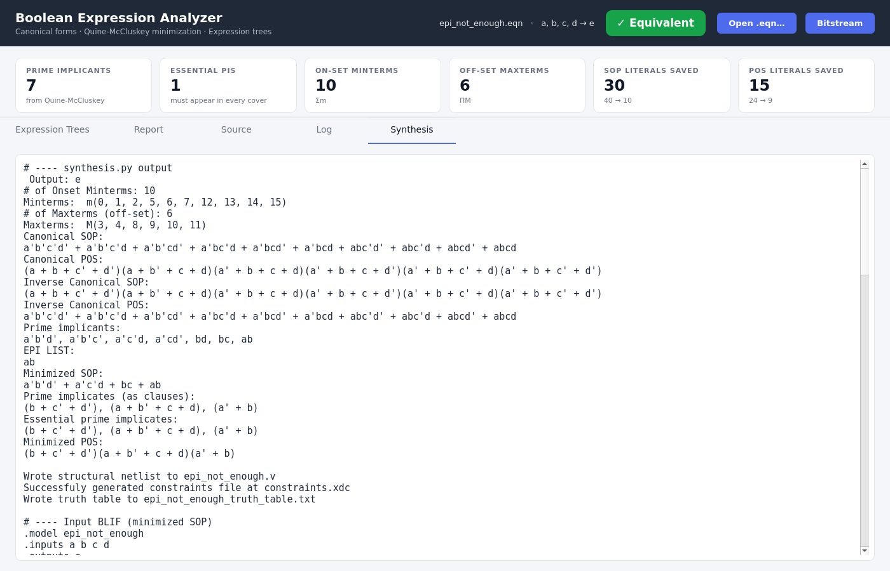

# LSE: Logic Synthesis Engine

A small logic synthesis engine written in Python for **EC551 Programming Assignment 1**
(`EC551_Program1_Rev1.pdf`). It reads a combinational circuit, computes canonical
forms, minimizes it with **Quine–McCluskey + Petrick's method**, and writes a **structural
Verilog netlist** plus a **Nexys A7 constraints file**, ready for Vivado.





---

## Contents

1. [Architecture](#architecture)
2. [Repository layout](#repository-layout)
3. [Installation](#installation)
4. [Tutorial: from structural Verilog to FPGA](#tutorial-from-structural-verilog-to-fpga)
5. [A harder example: when EPIs are not enough](#a-harder-example-when-epis-are-not-enough)
6. [Methods](#methods)
7. [Assignment requirements checklist](#assignment-requirements-checklist)
10. [AI usage](#ai-usage)

---

## Architecture

| Component | File | Role |
|---|---|---|
| Graph input frontend | `verilog2logic.sh` | Converts a combinational Verilog module into EQN and BLIF. |
| Parser / evaluator | `boolean_exp.py` | Parses `.eqn` files into an expression tree (shunting-yard), enumerates the ON-set, produces canonical SOP/POS of F and F′, and writes SOP cubes back out as `.eqn`. |
| Minimizer | `quine_mccluskey.py` | Given a canonical form of the boolean function, generates an optimized expression, written as a BLIF.|
| GUI | `lse.py` | PyQt5 application that ties everything together and shows every result. |
| Back end | `synthesis/synthesis.py` | Reads a BLIF, emits a gate-primitive structural Verilog module, a Nexys A7 `.xdc` and a truth table. |
---

## Repository layout

```
LSE/
├── README.md                    ← this file
├── EC551_Program1_Rev1.pdf      ← assignment
├── lse.py                       ← GUI entry point
├── boolean_exp.py               ← .eqn parser, expression tree, canonical forms
├── quine_mccluskey.py           ← QMC + Petrick's method
├── verilog2logic.sh             ← Verilog → .eqn/.blif/.pla/.aig (Yosys + ABC)
├── netlist2json.py              ← structural Verilog → JSON gate graph
├── example_verilogs/            ← input circuits (structural, continuous-assign, procedural, xor)
├── example_eqns/                ← generated by verilog2logic.sh   (git-ignored)
├── example_blifs/               ← generated by verilog2logic.sh   (git-ignored)
├── example_plas/                ← generated by verilog2logic.sh   (git-ignored)
├── example_aigs/                ← generated by verilog2logic.sh   (git-ignored)
├── netlists/                    ← gate-level Verilog (adder, mux, 10-input example)
├── netlist_jsons/               ← generated by netlist2json.py
├── synthesis/
│   ├── synthesis.py             ← BLIF → minimized structural Verilog + XDC + truth table
│   ├── nexys.xdc                ← Nexys A7 master constraints template (16 SW, 16 LED)
│   ├── constraints.xdc          ← generated: template with the used pins enabled
│   ├── <name>.v                 ← generated: structural netlist
│   └── <name>_truth_table.txt   ← generated: truth table
└── docs/images/                 ← screenshots used in this README
```

---

## Installation

Tested on Ubuntu (WSL2) with Python 3.10.

```bash
# Python dependencies (GUI + minimizer)
pip install --user PyQt5 matplotlib numpy

# Yosys with embedded ABC, only needed for verilog2logic.sh.
# Either a system yosys or the pip-installable WebAssembly build works:
pip install --user yowasp-yosys
```

On WSL, the GUI opens through WSLg. On Windows, Linux, or macOS it opens as a normal
desktop window.

---

## Tutorial: from structural Verilog to FPGA

This walkthrough uses `example_verilogs/sop_continuous_structural.v`, a two-level
AND-OR circuit built from gate primitives.

### Step 1: Describe the circuit in structural Verilog

```verilog
// example_verilogs/sop_continuous_structural.v
module example(
	input a, b, c, d,
	output e);

	wire t1;
	wire t2;

	and (t1, a, b);
	and (t2, c, d);

	or (e, t1, t2);
endmodule
```

Start from a combinational logic module circuit, here we show sop_continuous_structural.v. `example_verilogs/` also has the same
function written with `assign` (`sop_continuous_single.v`, `sop_continuous_mult.v`),
in an `always` block (`sop_procedural.v`), and as a multi-level XOR expression
(`mll.v`). Yosys turns all of them into the same kind of logic network.

### Step 2: Generate the `.eqn` with `verilog2logic.sh`

```bash
./verilog2logic.sh example_verilogs/sop_continuous_structural.v
```

```
Generates:
.v -> {eqn,blif,pla,aig}
```

The script runs Yosys (`read_verilog → hierarchy → proc → flatten → opt → techmap`),
then ABC (`collapse`), and writes four files named after the Verilog file:

| File | Content |
|---|---|
| `example_eqns/sop_continuous_structural.eqn` | the input for the GUI |
| `example_blifs/sop_continuous_structural.blif` | BLIF (can be fed straight into `synthesis.py`) |
| `example_plas/sop_continuous_structural.pla` | Espresso PLA |
| `example_aigs/sop_continuous_structural.aig` | binary AIGER |

```
# example_eqns/sop_continuous_structural.eqn
# Equations for "example" written by ABC on Wed Oct 28 15:59:21 2026
INORDER = a b c d;
OUTORDER = e;
e = (c * d) + (a * b);
```

Useful options:

```bash
./verilog2logic.sh                 # convert every .v in example_verilogs/
./verilog2logic.sh -m file.v       # keep multi-level logic in the .eqn (ABC strash instead of collapse)
./verilog2logic.sh -o out/ file.v  # write the example_* folders under out/ instead of the repo root
./verilog2logic.sh -h              # help
```

### Step 3: Open the `.eqn` in the GUI (Start here for Boolean Expressions)

```bash
python3 lse.py                                           # then click "Open .eqn…"
python3 lse.py example_eqns/sop_continuous_structural.eqn  # or pass the file directly
```

The file dialog opens in `example_eqns/`. Before a file is loaded, the window is empty:



After loading, the header shows the file, its inputs and output, and an **✓ Equivalent**
badge. The badge confirms that the canonical SOP, minimized SOP and minimized POS all
evaluate to the same ON-set as the original expression. The six cards under the header
give the assignment's numeric metrics (operations 7–10 and the literal savings for 5–6).

#### Report tab: operations 1–10


* **Minimization** shows the literal-minimized SOP (`e = a·b + c·d`, 28 → 4 literals)
  and POS (`e = (b + d)(b + c)(a + d)(a + c)`, 36 → 8 literals), the prime implicants,
  and the essential prime implicants as cubes (`11--`, `--11`).
* **Canonical forms** shows three columns: the original expression, its canonical SOP
  and the minimized expression. Each column has the canonical SOP, canonical POS, inverse
  canonical SOP, inverse canonical POS, and ON/OFF-set counts. All three columns
  agree, which is another view of the equivalence check.

#### Expression Trees tab



The trees are parsed from the original file, from the canonical SOP the program wrote, and
from the minimized SOP it wrote. Each tree is labeled with its literal count. They are
drawn with matplotlib, so you can zoom and pan with the toolbar and save them as images.

#### Source tab



The original `.eqn`, followed by the canonical and minimized versions produced by
`boolean_exp.write_eqn_from_SOP_cubes()`. These are real `.eqn` files that the program
parses again for the report and trees above.

#### Log tab



Everything the parser and minimizer print is captured here, so you can follow each step
of the algorithm. Excerpts for this example:

```
Expanded expression for e:
OR
├── AND
│   ├── VARIABLE: c
│   └── VARIABLE: d
└── AND
    ├── VARIABLE: a
    └── VARIABLE: b
Onset minterms: [3, 7, 11, 12, 13, 14, 15]
```

```
Generated QMC table from SOP list:
qmc Table:
2 ones: ['0011', '1100']
3 ones: ['0111', '1011', '1101', '1110']
4 ones: ['1111']

Merging minterms to find prime implicants:

Checking 0011
Checking terms 0011 and 0111
Adjacent terms found: 0011 and 0111
Merging 0011 and 0111 into 0-11
Checking terms 0011 and 1011
Adjacent terms found: 0011 and 1011
Merging 0011 and 1011 into -011
...
Remaining must-have implicants: ['11--', '--11']
...
No minterms left to cover, Petrick's method is not needed
```

### Step 4: Synthesize with the **Bitstream** button

Click **Bitstream**. The GUI writes the minimized SOP cubes to a temporary BLIF and runs
`synthesis/synthesis.py` on it. The Synthesis tab then shows the script's output and
every file it generated:



```
# ---- Input BLIF (minimized SOP)
.model sop_continuous_structural
.inputs a b c d
.outputs e
.names a b c d e
11-- 1
--11 1
.end
```

```verilog
// synthesis/sop_continuous_structural.v
`timescale 1ns / 1ps
module sop_continuous_structural (
    input a,
    input b,
    input c,
    input d,
    output e
);

    wire pt_0, pt_1;

    and g_and_0 (pt_0, c, d);
    and g_and_1 (pt_1, a, b);
    or g_or_e (e, pt_0, pt_1);

endmodule
```

```tcl
# synthesis/constraints.xdc (enabled lines only)
set_property -dict { PACKAGE_PIN J15   IOSTANDARD LVCMOS33 } [get_ports { a }]; #IO_L24N_T3_RS0_15 Sch=sw[0]
set_property -dict { PACKAGE_PIN L16   IOSTANDARD LVCMOS33 } [get_ports { b }]; #IO_L3N_T0_DQS_EMCCLK_14 Sch=sw[1]
set_property -dict { PACKAGE_PIN M13   IOSTANDARD LVCMOS33 } [get_ports { c }]; #IO_L6N_T0_D08_VREF_14 Sch=sw[2]
set_property -dict { PACKAGE_PIN R15   IOSTANDARD LVCMOS33 } [get_ports { d }]; #IO_L13N_T2_MRCC_14 Sch=sw[3]
set_property -dict { PACKAGE_PIN H17   IOSTANDARD LVCMOS33 } [get_ports { e }]; #IO_L18P_T2_A24_15 Sch=led[0]
```

### Step 5: Find the results

All synthesis outputs go to **`synthesis/`** and are named after the `.eqn` file you
opened:

| File | Description |
|---|---|
| `synthesis/sop_continuous_structural.v` | Structural Verilog using only `and`/`or`/`not`/`buf` primitives |
| `synthesis/constraints.xdc` | `nexys.xdc` with input *k* mapped to `SW[k]` and output *k* mapped to `LED[k]` |
| `synthesis/sop_continuous_structural_truth_table.txt` | Full truth table of the minimized function |

```
# synthesis/sop_continuous_structural_truth_table.txt
a b c d | e
0 0 0 0 | 0
0 0 0 1 | 0
0 0 1 0 | 0
0 0 1 1 | 1
...
1 1 1 1 | 1
```

> `constraints.xdc` is overwritten on every run, so copy it before you synthesize another
> circuit if you want to keep it.

The intermediate files from Step 2 stay in `example_eqns/`, `example_blifs/`,
`example_plas/` and `example_aigs/`.

`synthesis.py` also works without the GUI. It runs on any BLIF and writes to the current
directory:

```bash
cd synthesis
python3 synthesis.py ../example_blifs/sop_continuous_structural.blif
```

### Step 6: Put it on the Nexys A7

The **Bitstream** button produces the *inputs* for Vivado, not the `.bit` file itself:

1. Create an RTL project in Vivado for the Nexys A7 (`xc7a100tcsg324-1` for the A7-100T,
   `xc7a50ticsg324-1L` for the A7-50T).
2. Add `synthesis/<name>.v` as a design source and set it as top.
3. Add `synthesis/constraints.xdc` as a constraints file.
4. Run Synthesis → Implementation → Generate Bitstream, then program the board.

Switches `SW0`–`SW3` drive `a`–`d`, and `LED0` shows `e`. Compare the LED against
`<name>_truth_table.txt`.

---

## A harder example: when EPIs are not enough

`synthesis/epi_not_enough.v` is a function where the essential prime implicants do not cover
the ON-set by themselves. Running it through the same flow shows the full algorithm,
including Petrick's method:

```bash
./verilog2logic.sh synthesis/epi_not_enough.v
python3 lse.py example_eqns/epi_not_enough.eqn
```

ABC hands the GUI a multi-level, POS-shaped expression, and the parser handles it
directly:

```
e = (b + (!a * (!c + !d))) * (a + c + d + !b);
```



QMC finds **7 prime implicants** and only **1 essential** one (`11--` = `a·b`). The log
shows the chart being reduced and Petrick's method picking the cheapest cover for the
rest:

```
Prime implicants are:
000-
00-0
0-01
0-10
-1-1
11--
-11-

Optimizing Prime Implicant Chart
Remaining must-have implicants: ['11--']
...
Considering 11--:
Remove rows: {5}
Remove cols: {12, 13, 14, 15}

 There are missing minterms, using Pertick's to cover them.
After minterm 0: [['000-'], ['00-0']]
After minterm 1: [['000-'], ['0-01', '00-0']]
After minterm 2: [['00-0', '000-'], ['0-10', '000-'], ['0-01', '00-0']]
After minterm 5: [['-1-1', '0-10', '000-'], ['-1-1', '00-0', '000-'], ['0-01', '00-0'], ['0-01', '0-10', '000-']]
...
Petrick's method selected: ['-1-1', '0-10', '000-']
```

Result: `e = a·b + b·d + a′·c·d′ + a′·b′·c′`, 40 → 10 literals (75% saved).



This example has a *cyclic* core, so several minimum covers exist with the same cost.
`synthesis.py` runs its own minimizer on the BLIF and picks a different 10-literal
cover, `a′b′d′ + a′c′d + bc + ab`. Both covers have the same truth table:



---

## Methods

### 1. Front end: Verilog to two-level logic (`verilog2logic.sh`)

Yosys elaborates the module (`proc` turns `always` blocks into logic, `flatten` removes
hierarchy, `techmap` lowers it to simple cells) and writes a BLIF. The embedded ABC then
runs `collapse`, which rewrites each output as a function of the primary inputs only,
and writes EQN/BLIF/PLA/AIGER. With `-m`, ABC runs `strash` instead and keeps a
multi-level AND-inverter graph.

### 2. Parsing `.eqn` into an expression tree (`boolean_exp.parse_eqn`)

1. **Tokenize** each `variable = ...;` statement into `( ) ! * +` and identifiers. Read
   `INORDER` and `OUTORDER` for the inputs and the output.
2. **Substitute intermediate nodes.** Multi-level `.eqn` files define internal signals
   such as `n6 = a * b;`. These definitions are sorted by dependency and inlined
   (wrapped in parentheses), so the output depends only on primary inputs.
3. **Shunting-yard.** The token stream becomes a tree of nested tuples:
   `('VARIABLE', name) | ('CONSTANT', 0/1) | ('NOT', x) | ('AND', [...]) | ('OR', [...])`.
   Precedence is `! > * > +`. Chains of the same operator are flattened, so `a*b*c`
   becomes a single 3-input `AND`.

### 3. Canonical forms (operations 1–4, 9–10)

`onset_minterms_brute_force()` evaluates the tree on all 2ⁿ input combinations, with
the first input in `INORDER` as the most significant bit. The ON-set gives Σm (canonical
SOP). Its complement gives ΠM (canonical POS). For the inverse function, F′'s canonical
SOP uses F's maxterm indices and F′'s canonical POS uses F's minterm indices.

### 4. Literal-minimized SOP: Quine–McCluskey (`quine_mccluskey.QMC`)

1. **Group** the minterms by their number of 1s (`table_from_SOP`).
2. **Merge** terms in neighbouring groups that differ in exactly one fixed bit, replacing
   that bit with `-` (`check_adjacency`, `merge_terms`). Repeat until nothing changes.
   The terms left are the **prime implicants**.
3. **Prime implicant chart.** Each PI is expanded back into the minterms it covers
   (`check_term_coverage`) and becomes one row of a NumPy 0/1 matrix.
4. **Essential PIs.** A column with a single 1 marks a minterm that only one PI covers,
   so that PI is essential (`find_EPIs`). EPI rows and the columns they cover are cleared
   (`reduce_chart`).
5. **Petrick's method.** For any minterms still uncovered, the product of sums
   "(PIs covering m₁)(PIs covering m₂)…" is multiplied out one minterm at a time.
   Absorption (X + XY = X) is applied after each step. The cheapest product is chosen
   by (number of terms, number of literals).

### 5. Literal-minimized POS (operation 6)

QMC runs on the **OFF-set**, which minimizes F′ as an SOP. De Morgan then turns each F′
product term into an F sum term (every literal complemented), giving a minimal POS of F.

### 6. Verification

The minimized SOP is written to a real `.eqn` file (`write_eqn_from_SOP_cubes`),
parsed again, and its ON-set is compared with the original. The canonical SOP and the
minimized POS tree go through the same check. The header badge reports the result.

### 7. Synthesis back end (`synthesis/synthesis.py`)

* **BLIF reader.** Handles `.model/.inputs/.outputs/.names`, line continuations,
  `-` don't-care inputs, multi-output `.names` rows, and OFF-set-only covers
  (rows that all have output `0`).
* **Independent minimizer.** Its own Quine–McCluskey and EPI extraction. The remaining
  cover is found by exhaustive search over candidate combinations when there are ≤ 16
  candidates, and by a greedy most-coverage heuristic otherwise. It also prints the
  canonical forms and the minimized SOP/POS, which serves as a second check on the GUI.
* **Netlist generation.** Each complemented input gets one shared `not` gate
  (`<x>_n`). Each multi-literal product term gets an `and` gate (`pt_k`). Each output
  is an `or` of its product terms, or a `buf` if there is only one.
* **Constraints.** Input *k* is mapped to `SW[k]` and output *k* to `LED[k]` by
  enabling and renaming the matching lines of the Nexys A7 master `nexys.xdc`.
* **Truth table export.** `<name>_truth_table.txt`, for checking the board by hand.

---

## Assignment requirements checklist

| # | Requirement | Where |
|---|---|---|
| Input | File via CLI argument and file picker; GUI | GUI has an **Open .eqn…** button `verilog2logic.sh` converts circuits |
| Input | Boolean algebraic function (SOP, POS, multi-level) | `.eqn` via `boolean_exp.py` |
| Input | Graph-based circuit | Structural verilog describes the circuit + `verilog2logic.sh` prepares it for loading |
| 1–4 | Canonical SOP/POS of F and F′ | Report tab, sections 1–4 (all three columns) |
| 5 | Literal-minimized SOP + literals saved | Report §5, *SOP literals saved* card |
| 6 | Literal-minimized POS + literals saved | Report §6, *POS literals saved* card |
| 7 | Prime implicant count | Report §7, *Prime implicants* card |
| 8 | Essential prime implicant count | Report §8, *Essential PIs* card |
| 9–10 | ON-set minterms / OFF-set maxterms | Report §9–10, *ON-set* / *OFF-set* cards |
| 11 | Custom #1: expression tree visualisation | Expression Trees tab |
| 12 | Custom #2: truth table exporter | Synthesis tab  |
| Out | Structural Verilog from gate primitives | `synthesis/<name>.v` |
| Out | FPGA deployment | `synthesis/constraints.xdc` → Vivado → Nexys A7 |

---

## AI usage

As the course AI policy requires, generative AI (Anthropic's Claude) was used for
parts of this project. All generated code was reviewed and integrated by the team:

* `verilog2logic.sh`: the Yosys + ABC script.
* `GUI frontend was designed by AI. The synthesis integration was added afterwards by us.
* `boolean_exp.py`: 
  - `expression_tree()` AI wrote the code that visualizes an already parsed tree.
  - `substitute_equations()` AI suggested that we have this function to allow multi layer expressions.
* The snippets and screenshots in this README were generated by Claude Code using the repository history and real runs of the tool.

The core algorithms (`.eqn` parsing, shunting-yard, Quine–McCluskey, Petrick's method,
and the `synthesis.py` back end) were written by the team.
